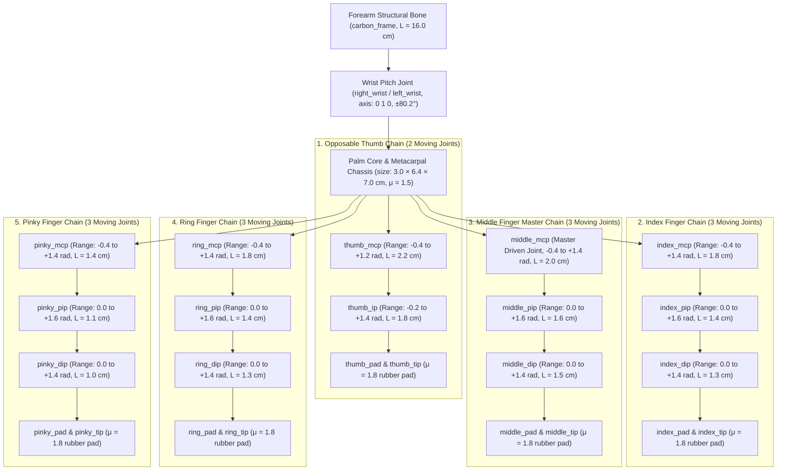

# SECTION 8: 14-Joint Dexterous Hands, Bio-Mechanical Tendon Coupling & Full 51-Body CAD/STL Architecture

**Project:** Cyrus-H04 Full-Scale Humanoid Robotics Initiative  
**Document ID:** `CYRUS-TR-2026-SEC08-REV1`  
**Primary Source Files:**  
- [`models/cyrus.xml`](file:///C:/Users/prajval/robotics/cyrus/models/cyrus.xml) (Full 51-Body, 31-Actuator Reference Model — $54.75\,\text{KB}$)  
- [`models/cyrus_mjx.xml`](file:///C:/Users/prajval/robotics/cyrus/models/cyrus_mjx.xml) (Full-Body GPU MJX Model — $54.80\,\text{KB}$)  
- [`models/cyrus_12dof_mjx.xml`](file:///C:/Users/prajval/robotics/cyrus/models/cyrus_12dof_mjx.xml) (Reduced 12-DoF High-Throughput Locomotion Model — $40.03\,\text{KB}$)  
- [`models/cyrus_human_feet.xml`](file:///C:/Users/prajval/robotics/cyrus/models/cyrus_human_feet.xml) & [`models/cyrus_arena_12.xml`](file:///C:/Users/prajval/robotics/cyrus/models/cyrus_arena_12.xml) ($306.84\,\text{KB}$)  
- [`scripts/build_human_feet_xml.py`](file:///C:/Users/prajval/robotics/cyrus/scripts/build_human_feet_xml.py) & [`scripts/update_all_humanoid_models.py`](file:///C:/Users/prajval/robotics/cyrus/scripts/update_all_humanoid_models.py)

---

## Executive Overview: Why Two Model Tiers Exist in Cyrus-H04

In modern full-scale humanoid engineering, a fundamental computational trade-off exists between **kinematic completeness** (dexterous hands, multi-axis spine, articulated neck, and sculpted CAD meshes) and **GPU contact-solver throughput** ($1,024$ parallel environments running at $>15,000\,\text{FPS}$).

To achieve both without compromise, the Cyrus-H04 physics architecture is structured as a **Dual-Tier Model Hierarchy**:
1. **The Full 51-Body / 31-Actuator Reference Architecture ([`models/cyrus.xml`](file:///C:/Users/prajval/robotics/cyrus/models/cyrus.xml) & [`models/cyrus_mjx.xml`](file:///C:/Users/prajval/robotics/cyrus/models/cyrus_mjx.xml)):**
   Models the complete humanoid anatomy—including **14 moving phalangeal joints per hand (28 total across both hands)**, 3-DoF lumbar waist (`waist_yaw`, `waist_roll`, `waist_pitch`), 2-DoF articulated neck (`neck_yaw`, `neck_pitch`), 5-DoF arms with wrist dorsiflexion (`right_wrist`, `left_wrist`), and 21 custom parametric STL hardware meshes. This model powers **quadrupedal ground recovery, push-up stand-up reflexes, Hand Re-Latch balance recovery, and dexterous manipulation**.
2. **The Reduced 12-DoF MJX Locomotion & Balance Model ([`models/cyrus_12dof_mjx.xml`](file:///C:/Users/prajval/robotics/cyrus/models/cyrus_12dof_mjx.xml)):**
   Condenses the upper-body mass ($18.90\,\text{kg}$) into an inertial equivalent trunk and arm assembly while preserving 100% of the lower-body 6-DoF-per-leg kinematics, allowing the JAX/MJX XLA solver to simulate $1,024$ humanoids in parallel within $6\,\text{GB}$ of RTX 3050 VRAM.

> [!IMPORTANT]
> **Inertial Identity Guarantee (`mass="0"` Visual Shells):** Across all Cyrus XML models, decorative and structural CAD visual geometries (such as CNC 6061-T6 brackets, gold-anodized QDD servo stators, carbon-fiber collar clamps, and sneaker uppers) are explicitly tagged with `contype="0" conaffinity="0" mass="0"`. This guarantees that upgrading or swapping visual CAD meshes produces **zero drift** in link masses, Center of Mass ($\mathbf{r}_{\text{CoM}}$) offsets, or $3\times 3$ inertia tensors.

---

## 8.1 14-Joint Dexterous Anatomical Hand Architecture (28 Phalangeal Joints Total)

### 8.1.1 Close-Up 3D MuJoCo Render & Skeletal Topology


Unlike conventional humanoid models that terminate the forearm in a rigid spherical club or a simple 1-DoF paralleljaw gripper, [`models/cyrus.xml`](file:///C:/Users/prajval/robotics/cyrus/models/cyrus.xml#L194-L451) implements a biologically accurate **14-DoF skeletal hand per arm** (28 moving finger/thumb joints total, plus 2 wrist pitch joints = **30 distal hand/wrist degrees of freedom**).



### 8.1.2 Complete Phalangeal Joint & Geometry Specification Table (Per Hand)

Every phalangeal segment in [`models/cyrus.xml`](file:///C:/Users/prajval/robotics/cyrus/models/cyrus.xml#L204-L298) is modeled with a tapered 6061-T6 aluminum capsule (`density="400"`), progressive viscous joint damping, and high-friction elastomeric distal pads (`material="finger_pad"`, $\mu_t = 1.8$):

| # | Joint Identifier | Anatomical Joint Name | Parent $\to$ Child Body | Hinge Axis | Angular Range ($\text{rad}$) | Angular Range ($\text{deg}$) | Bone Length ($L$) | Capsule Radius ($r$) | Viscous Damping ($b$) |
| :-: | :--- | :--- | :--- | :---: | :---: | :---: | :---: | :---: | :---: |
| **0** | `*_wrist` | Radiocarpal Pitch | `forearm` $\to$ `hand` | `(0, 1, 0)` | $[-1.40, +1.40]$ | $[-80.2^\circ, +80.2^\circ]$ | $7.0\,\text{cm}$ (Palm) | $1.5 \times 3.2\,\text{cm}$ | $0.80\,\text{N}\cdot\text{m}\cdot\text{s/rad}$ |
| **1** | `*_thumb_mcp` | Thumb Metacarpophalangeal | `hand` $\to$ `thumb_proximal` | `(0, 1, 0)` | $[-0.40, +1.20]$ | $[-22.9^\circ, +68.8^\circ]$ | $2.2\,\text{cm}$ | $6.5\,\text{mm}$ | $0.10\,\text{N}\cdot\text{m}\cdot\text{s/rad}$ |
| **2** | `*_thumb_ip` | Thumb Interphalangeal | `thumb_proximal` $\to$ `thumb_distal` | `(0, 1, 0)` | $[-0.20, +1.40]$ | $[-11.5^\circ, +80.2^\circ]$ | $1.8\,\text{cm}$ | $5.5\,\text{mm}$ | $0.08\,\text{N}\cdot\text{m}\cdot\text{s/rad}$ |
| **3** | `*_index_mcp` | Index Proximal Knuckle | `hand` $\to$ `index_proximal` | `(0, 1, 0)` | $[-0.40, +1.40]$ | $[-22.9^\circ, +80.2^\circ]$ | $1.8\,\text{cm}$ | $5.5\,\text{mm}$ | $0.08\,\text{N}\cdot\text{m}\cdot\text{s/rad}$ |
| **4** | `*_index_pip` | Index Intermediate PIP | `index_proximal` $\to$ `index_intermediate` | `(0, 1, 0)` | $[0.00, +1.60]$ | $[0.0^\circ, +91.7^\circ]$ | $1.4\,\text{cm}$ | $4.8\,\text{mm}$ | $0.06\,\text{N}\cdot\text{m}\cdot\text{s/rad}$ |
| **5** | `*_index_dip` | Index Distal DIP | `index_intermediate` $\to$ `index_distal` | `(0, 1, 0)` | $[0.00, +1.40]$ | $[0.0^\circ, +80.2^\circ]$ | $1.3\,\text{cm}$ | $4.2\,\text{mm}$ | $0.05\,\text{N}\cdot\text{m}\cdot\text{s/rad}$ |
| **6** | `*_middle_mcp` | Middle Proximal Knuckle | `hand` $\to$ `middle_proximal` | `(0, 1, 0)` | $[-0.40, +1.40]$ | $[-22.9^\circ, +80.2^\circ]$ | $2.0\,\text{cm}$ | $5.5\,\text{mm}$ | $0.08\,\text{N}\cdot\text{m}\cdot\text{s/rad}$ |
| **7** | `*_middle_pip` | Middle Intermediate PIP | `middle_proximal` $\to$ `middle_intermediate` | `(0, 1, 0)` | $[0.00, +1.60]$ | $[0.0^\circ, +91.7^\circ]$ | $1.6\,\text{cm}$ | $4.8\,\text{mm}$ | $0.06\,\text{N}\cdot\text{m}\cdot\text{s/rad}$ |
| **8** | `*_middle_dip` | Middle Distal DIP | `middle_intermediate` $\to$ `middle_distal` | `(0, 1, 0)` | $[0.00, +1.40]$ | $[0.0^\circ, +80.2^\circ]$ | $1.5\,\text{cm}$ | $4.2\,\text{mm}$ | $0.05\,\text{N}\cdot\text{m}\cdot\text{s/rad}$ |
| **9** | `*_ring_mcp` | Ring Proximal Knuckle | `hand` $\to$ `ring_proximal` | `(0, 1, 0)` | $[-0.40, +1.40]$ | $[-22.9^\circ, +80.2^\circ]$ | $1.8\,\text{cm}$ | $5.5\,\text{mm}$ | $0.08\,\text{N}\cdot\text{m}\cdot\text{s/rad}$ |
| **10** | `*_ring_pip` | Ring Intermediate PIP | `ring_proximal` $\to$ `ring_intermediate` | `(0, 1, 0)` | $[0.00, +1.60]$ | $[0.0^\circ, +91.7^\circ]$ | $1.4\,\text{cm}$ | $4.8\,\text{mm}$ | $0.06\,\text{N}\cdot\text{m}\cdot\text{s/rad}$ |
| **11** | `*_ring_dip` | Ring Distal DIP | `ring_intermediate` $\to$ `ring_distal` | `(0, 1, 0)` | $[0.00, +1.40]$ | $[0.0^\circ, +80.2^\circ]$ | $1.3\,\text{cm}$ | $4.2\,\text{mm}$ | $0.05\,\text{N}\cdot\text{m}\cdot\text{s/rad}$ |
| **12** | `*_pinky_mcp` | Pinky Proximal Knuckle | `hand` $\to$ `pinky_proximal` | `(0, 1, 0)` | $[-0.40, +1.40]$ | $[-22.9^\circ, +80.2^\circ]$ | $1.4\,\text{cm}$ | $5.5\,\text{mm}$ | $0.08\,\text{N}\cdot\text{m}\cdot\text{s/rad}$ |
| **13** | `*_pinky_pip` | Pinky Intermediate PIP | `pinky_proximal` $\to$ `pinky_intermediate` | `(0, 1, 0)` | $[0.00, +1.60]$ | $[0.0^\circ, +91.7^\circ]$ | $1.1\,\text{cm}$ | $4.8\,\text{mm}$ | $0.06\,\text{N}\cdot\text{m}\cdot\text{s/rad}$ |
| **14** | `*_pinky_dip` | Pinky Distal DIP | `pinky_intermediate` $\to$ `pinky_distal` | `(0, 1, 0)` | $[0.00, +1.40]$ | $[0.0^\circ, +80.2^\circ]$ | $1.0\,\text{cm}$ | $4.2\,\text{mm}$ | $0.05\,\text{N}\cdot\text{m}\cdot\text{s/rad}$ |

---

## 8.2 Bio-Mechanical Tendon Coupling & Grasp Synergy Formulation

### 8.2.1 Why Underactuated Tendon Coupling is Required
Driving 28 independent finger joints with 28 separate motors would add $>2.5\,\text{kg}$ of distal hand mass (severely degrading arm swing dynamics) and expand the RL action space by 28 dimensions. In human anatomy, the **flexor digitorum profundus (FDP)** and **flexor digitorum superficialis (FDS)** tendons naturally couple the proximal (MCP), intermediate (PIP), and distal (DIP) phalanges along a low-dimensional **Postural Grasp Synergy Manifold**.

In [`models/cyrus.xml`](file:///C:/Users/prajval/robotics/cyrus/models/cyrus.xml#L689-L735), Cyrus replicates this exact biological tendon routing using **24 Polynomial Equality Constraints** (`<equality>` tag with `polycoef="a0 a1 a2 a3 a4"`), reducing 28 phalangeal joints to **4 Master Synergy Actuators** (2 per hand: `*_finger_act` driving `middle_mcp`, and `*_thumb_act` driving `thumb_mcp`).

### 8.2.2 Exact Polynomial Tendon Constraint Equations

For any coupled joint pair $(\theta_1, \theta_2)$ in MuJoCo, the `<joint>` equality constraint enforces:

$$
\theta_1 - \left(a_0 + a_1 \theta_2 + a_2 \theta_2^2 + a_3 \theta_2^3 + a_4 \theta_2^4\right) = 0
$$

In Cyrus-H04, linear tendon pulley ratios ($a_0 = a_2 = a_3 = a_4 = 0$) govern the entire phalangeal cascade for each hand $s \in \{\text{right}, \text{left}\}$:

1. **Opposable Thumb Interphalangeal Coupling ($a_1 = 0.85$):**
   $$
   \theta_{s,\text{thumb\_ip}} = 0.85 \cdot \theta_{s,\text{thumb\_mcp}}
   $$
2. **Inter-Finger Metacarpophalangeal (MCP) Transverse Tendon Coupling ($a_1 = 1.00$):**
   All four finger knuckles track the master `middle_mcp` tendon actuator while retaining soft constraint compliance under uneven object or floor contact:
   $$
   \theta_{s,f\text{\_mcp}} = 1.00 \cdot \theta_{s,\text{middle\_mcp}}, \quad \forall f \in \{\text{index}, \text{ring}, \text{pinky}\}
   $$
3. **Proximal-to-Intermediate (MCP $\to$ PIP) Flexor Superficialis Ratio ($a_1 = 0.90$):**
   $$
   \theta_{s,f\text{\_pip}} = 0.90 \cdot \theta_{s,f\text{\_mcp}}, \quad \forall f \in \{\text{index}, \text{middle}, \text{ring}, \text{pinky}\}
   $$
4. **Intermediate-to-Distal (PIP $\to$ DIP) Flexor Profundus Ratio ($a_1 = 0.80$):**
   $$
   \theta_{s,f\text{\_dip}} = 0.80 \cdot \theta_{s,f\text{\_pip}} = 0.80 \cdot \left(0.90 \cdot \theta_{s,f\text{\_mcp}}\right) = 0.72 \cdot \theta_{s,f\text{\_mcp}}
   $$

### 8.2.3 Dual Operating Modes: Power Grasp Curl vs. Planar Mat Press Mode

```
   MODE A: POWER GRASP SYNERGY (u_finger = +1.40 rad)      MODE B: PLANAR MAT PRESS MODE (u_finger = -0.25 rad)
   ==================================================      ====================================================
              [Palm Core]                                                 [Forearm Bone]
                   |                                                            |
                   o  <-- MCP = +1.40 rad (+80.2 deg)                           o  <-- Wrist Pitch = -1.05 rad
                  /                                                             |
                 o    <-- PIP = +1.26 rad (+72.2 deg)             ==============O==============  <-- Flat Palm +
                  \                                               [Thumb] [Palm Core] [Fingers]      Splayed Fingers
                   o  <-- DIP = +1.01 rad (+57.7 deg)             ~~~~~~~~~~~~~~~~~~~~~~~~~~~~~      (-14.3 deg)
                                                                  //////// FLOOR MAT //////////      mu_palm = 1.5
      Total Finger Curl = 210.1 deg ( Cylindrical Lock )           mu_pads = 1.8 (6 Contact Sites per Hand)
```

* **Mode A — Cylindrical Power Grasp ($u_{\text{finger}} = +1.40\,\text{rad}$):**
  When the master knuckle flexes to $+80.2^\circ$, the PIP joint curls to $+72.2^\circ$ and the DIP joint curls to $+57.7^\circ$, producing a total cumulative fingertip wrap angle of:
  $$
  \Theta_{\text{wrap}} = \theta_{\text{mcp}} + \theta_{\text{pip}} + \theta_{\text{dip}} = (1.00 + 0.90 + 0.72)\,\theta_{\text{mcp}} = 2.62 \times 80.2^\circ = 210.1^\circ
  $$
* **Mode B — Planar Mat Press Mode ($u_{\text{finger}} \in [-0.40, -0.25]\,\text{rad}$):**
  Because the MCP joints permit negative hyperextension down to $-0.40\,\text{rad}$ ($-22.9^\circ$) while the PIP and DIP joints are bounded at $0.0\,\text{rad}$ by their anatomical dorsal joint stops (`range="0.0 1.6"`), commanding $u_{\text{finger}} = -0.25\,\text{rad}$ splays the fingers completely flat and parallel to the palm core (`right_palm_core` / `left_palm_core`). When combined with wrist dorsiflexion (`right_wrist`), the hand forms a wide, high-traction plantar support pad ($\mu_{\text{palm}} = 1.5$, $\mu_{\text{finger\_pad}} = 1.8$) capable of supporting the robot's entire bodyweight during push-ups and quadrupedal balance recovery.

---

## 8.3 Full 51-Body / 31-Actuator Model vs. Reduced 12-DoF MJX Model

### 8.3.1 Architectural Comparison Across Model Variants

Your `models/` directory contains five specialized XML definitions engineered for distinct stages of training, multi-agent arena benchmarking, and hardware-in-the-loop visualization:

| Model File | File Size | Total Bodies (`nbody`) | DoF (`nv`) | Actuators (`nu`) | Primary Engineering Purpose |
| :--- | :---: | :---: | :---: | :---: | :--- |
| [`models/cyrus.xml`](file:///C:/Users/prajval/robotics/cyrus/models/cyrus.xml) | $54.75\,\text{KB}$ | **51** (incl. world & mocap) | **61** | **31** | Master full-body reference model: 28 finger joints, 3-DoF spine, 2-DoF neck, 21 CAD STL meshes, stand-up & Hand Re-Latch reflex. |
| [`models/cyrus_mjx.xml`](file:///C:/Users/prajval/robotics/cyrus/models/cyrus_mjx.xml) | $54.80\,\text{KB}$ | **51** | **61** | **31** | GPU XLA-compatible full-body model with implicitfast solver tuning for whole-body stand-up RL. |
| [`models/cyrus_12dof_mjx.xml`](file:///C:/Users/prajval/robotics/cyrus/models/cyrus_12dof_mjx.xml) | $40.03\,\text{KB}$ | **14** | **18** | **12** | High-speed 1,024-swarm GPU balance & push-recovery model ($31.45\,\text{kg}$, $dt = 0.0025\,\text{s}$). |
| [`models/cyrus_human_feet.xml`](file:///C:/Users/prajval/robotics/cyrus/models/cyrus_human_feet.xml) | $40.03\,\text{KB}$ | **14** | **18** | **12** | 12-DoF model equipped with parametric sculpted multi-geom human shoes, heel counters, and ankle clevis forks. |
| [`models/cyrus_arena_12.xml`](file:///C:/Users/prajval/robotics/cyrus/models/cyrus_arena_12.xml) | $306.84\,\text{KB}$ | **158+** | **216** | **144** | 12-Robot simultaneous multi-humanoid exhibition & stress-test arena within a single MuJoCo world. |
| [`models/cyrus_ghost_trajectory.xml`](file:///C:/Users/prajval/robotics/cyrus/models/cyrus_ghost_trajectory.xml) | $40.62\,\text{KB}$ | **27** | **36** | **12** | Dual-body overlay model pairing the active physics robot with a kinematic translucent "Ghost" reference skeleton. |

### 8.3.2 Complete 31-Actuator Allocation in `models/cyrus.xml`

In the full-body configuration ([`models/cyrus.xml`](file:///C:/Users/prajval/robotics/cyrus/models/cyrus.xml#L607-L653)), all 31 position servos (`<position>`) are grouped into 6 anatomical subsystems with hardware-matched PD stiffness ($K_p$), damping ($K_v$), control ranges, and peak torque clamping (`forcerange`):

| Subsystem | Actuator Count | Actuator Names | Proportional Gain ($K_p$) | Derivative Gain ($K_v$) | Control Range ($\text{rad}$) | Peak Force/Torque Limit ($\tau_{\max}$) |
| :--- | :---: | :--- | :---: | :---: | :---: | :---: |
| **1. Lumbar Spine (3-DoF)** | **3** | `waist_yaw_act`<br>`waist_roll_act`<br>`waist_pitch_act` | $250$<br>$300$<br>$500$ | $25$<br>$30$<br>$50$ | $[-0.8, +0.8]$<br>$[-0.4, +0.4]$<br>$[-0.5, +0.7]$ | $\pm 120\,\text{N}\cdot\text{m}$<br>$\pm 150\,\text{N}\cdot\text{m}$<br>$\pm 220\,\text{N}\cdot\text{m}$ |
| **2. Head & Neck (2-DoF)** | **2** | `neck_yaw_act`<br>`neck_pitch_act` | $50$<br>$60$ | $5$<br>$6$ | $[-1.4, +1.4]$<br>$[-0.7, +0.7]$ | $\pm 35\,\text{N}\cdot\text{m}$<br>$\pm 40\,\text{N}\cdot\text{m}$ |
| **3. Right Arm & Wrist (5-DoF)** | **5** | `right_shoulder_pitch_act`<br>`right_shoulder_roll_act`<br>`right_shoulder_yaw_act`<br>`right_elbow_act`<br>`right_wrist_act` | $300$<br>$250$<br>$80$<br>$250$<br>$150$ | $30$<br>$25$<br>$8$<br>$25$<br>$15$ | $[-2.2, +1.5]$<br>$[-1.8, +0.5]$<br>$[-1.5, +1.5]$<br>$[-2.2, 0.0]$<br>$[-1.0, +1.0]$ | $\pm 120\,\text{N}\cdot\text{m}$<br>$\pm 100\,\text{N}\cdot\text{m}$<br>$\pm 70\,\text{N}\cdot\text{m}$<br>$\pm 90\,\text{N}\cdot\text{m}$<br>$\pm 40\,\text{N}\cdot\text{m}$ |
| **4. Left Arm & Wrist (5-DoF)** | **5** | `left_shoulder_pitch_act`<br>`left_shoulder_roll_act`<br>`left_shoulder_yaw_act`<br>`left_elbow_act`<br>`left_wrist_act` | $300$<br>$250$<br>$80$<br>$250$<br>$150$ | $30$<br>$25$<br>$8$<br>$25$<br>$15$ | $[-2.2, +1.5]$<br>$[-0.5, +1.8]$<br>$[-1.5, +1.5]$<br>$[-2.2, 0.0]$<br>$[-1.0, +1.0]$ | $\pm 120\,\text{N}\cdot\text{m}$<br>$\pm 100\,\text{N}\cdot\text{m}$<br>$\pm 70\,\text{N}\cdot\text{m}$<br>$\pm 90\,\text{N}\cdot\text{m}$<br>$\pm 40\,\text{N}\cdot\text{m}$ |
| **5. Bilateral Legs (12-DoF)** | **12** | `*_hip_yaw_act` ($\times 2$)<br>`*_hip_roll_act` ($\times 2$)<br>`*_hip_pitch_act` ($\times 2$)<br>`*_knee_act` ($\times 2$)<br>`*_ankle_pitch_act` ($\times 2$)<br>`*_ankle_roll_act` ($\times 2$) | $350$<br>$180$<br>$700$<br>$800$<br>$600$<br>$150$ | $35$<br>$18$<br>$70$<br>$80$<br>$60$<br>$15$ | $[-0.6, +0.6]$<br>$[-0.6, +0.6]$<br>$[-1.4, +0.8]$<br>$[0.0, +2.2]$<br>$[-0.8, +0.8]$<br>$[-0.4, +0.4]$ | $\pm 140\,\text{N}\cdot\text{m}$<br>$\pm 180\,\text{N}\cdot\text{m}$<br>$\pm 240\,\text{N}\cdot\text{m}$<br>$\pm 260\,\text{N}\cdot\text{m}$<br>$\pm 180\,\text{N}\cdot\text{m}$<br>$\pm 130\,\text{N}\cdot\text{m}$ |
| **6. Dexterous Hands (4-DoF Synergy)** | **4** | `right_finger_act` (`middle_mcp`)<br>`right_thumb_act` (`thumb_mcp`)<br>`left_finger_act` (`middle_mcp`)<br>`left_thumb_act` (`thumb_mcp`) | $150$<br>$120$<br>$150$<br>$120$ | $15$<br>$12$<br>$15$<br>$12$ | $[-0.4, +1.4]$<br>$[-0.4, +1.2]$<br>$[-0.4, +1.4]$<br>$[-0.4, +1.2]$ | $\pm 60\,\text{N}\cdot\text{m}$<br>$\pm 50\,\text{N}\cdot\text{m}$<br>$\pm 60\,\text{N}\cdot\text{m}$<br>$\pm 50\,\text{N}\cdot\text{m}$ |

---

## 8.4 Parametric 3D CAD & STL Hardware Mesh Library (`models/meshes/`)

### 8.4.1 Inventory of the 21 Custom STL Hardware Meshes

To ensure visual and mechanical fidelity to real-world CNC-machined 6061-T6 aluminum frames, quasi-direct-drive (QDD) planetary actuators, and 6-axis force-torque sensors, [`models/meshes/`](file:///C:/Users/prajval/robotics/cyrus/models/meshes) contains **21 binary STL CAD meshes** totaling $899.76\,\text{KB}$:

| # | STL Mesh File | Size (Bytes) | Triangle Count | Anatomical / Mechanical Component |
| :-: | :--- | :---: | :---: | :--- |
| **1** | [`cranium_head_shell.stl`](file:///C:/Users/prajval/robotics/cyrus/models/meshes/cranium_head_shell.stl) | $270,484$ | $5,408$ | Sculpted cranial dome, panoramic visor bezel, and stereo camera housing. |
| **2** | [`mandible_jaw.stl`](file:///C:/Users/prajval/robotics/cyrus/models/meshes/mandible_jaw.stl) | $24,084$ | $480$ | Angled lower jawline and chin impact guard. |
| **3** | [`thoracic_torso_shell.stl`](file:///C:/Users/prajval/robotics/cyrus/models/meshes/thoracic_torso_shell.stl) | $30,884$ | $616$ | Upper chest armor shell, dual pectoral plates, and rear 48V LiPo battery bay cover. |
| **4** | [`lumbar_waist_shell.stl`](file:///C:/Users/prajval/robotics/cyrus/models/meshes/lumbar_waist_shell.stl) | $18,084$ | $360$ | Segmented lumbar spinal column shroud and oblique flank guards. |
| **5** | [`pelvis_chassis_shell.stl`](file:///C:/Users/prajval/robotics/cyrus/models/meshes/pelvis_chassis_shell.stl) | $20,084$ | $400$ | Central CNC 6061-T6 pelvic billet subframe and hip yaw stator mounts. |
| **6** | [`upper_arm_shell.stl`](file:///C:/Users/prajval/robotics/cyrus/models/meshes/upper_arm_shell.stl) | $18,084$ | $360$ | Bicep/tricep aerodynamic fairing around the 3K carbon-fiber humeral tube. |
| **7** | [`forearm_shell.stl`](file:///C:/Users/prajval/robotics/cyrus/models/meshes/forearm_shell.stl) | $18,084$ | $360$ | Dorsal and ventral forearm armor housing the tendon servo winches. |
| **8** | [`wrist_ft_sensor.stl`](file:///C:/Users/prajval/robotics/cyrus/models/meshes/wrist_ft_sensor.stl) | $6,484$ | $128$ | Distal 6-axis Force-Torque (FT) cylindrical load-cell puck at the wrist joint. |
| **9** | [`palm_chassis_right.stl`](file:///C:/Users/prajval/robotics/cyrus/models/meshes/palm_chassis_right.stl) | $18,084$ | $360$ | Right metacarpal structural palm chassis with 5-finger knuckle clevis mounts. |
| **10** | [`palm_chassis_left.stl`](file:///C:/Users/prajval/robotics/cyrus/models/meshes/palm_chassis_left.stl) | $18,084$ | $360$ | Left metacarpal structural palm chassis with 5-finger knuckle clevis mounts. |
| **11** | [`thigh_armor_shell.stl`](file:///C:/Users/prajval/robotics/cyrus/models/meshes/thigh_armor_shell.stl) | $35,284$ | $704$ | Quadriceps frontal shield and twin-spar lateral femoral structural shell. |
| **12** | [`shin_calf_housing.stl`](file:///C:/Users/prajval/robotics/cyrus/models/meshes/shin_calf_housing.stl) | $28,084$ | $560$ | Tapered tibial shin guard and posterior gastrocnemius calf contour. |
| **13** | [`shin_clevis_frame.stl`](file:///C:/Users/prajval/robotics/cyrus/models/meshes/shin_clevis_frame.stl) | $52,884$ | $1,056$ | Distal dual-pushrod ankle clevis fork and mechanical pivot hub. |
| **14** | [`ankle_ft_sensor.stl`](file:///C:/Users/prajval/robotics/cyrus/models/meshes/ankle_ft_sensor.stl) | $6,484$ | $128$ | Lower-leg 6-axis Force-Torque (FT) sensor puck mounted between ankle roll and foot sole. |
| **15** | [`human_foot_right.stl`](file:///C:/Users/prajval/robotics/cyrus/models/meshes/human_foot_right.stl) | $66,084$ | $1,320$ | Sculpted right anatomical sneaker upper (heel counter, instep bridge, metatarsal forefoot, rounded toe box). |
| **16** | [`human_foot_left.stl`](file:///C:/Users/prajval/robotics/cyrus/models/meshes/human_foot_left.stl) | $66,084$ | $1,320$ | Sculpted left anatomical sneaker upper. |
| **17** | [`foot_sole_right.stl`](file:///C:/Users/prajval/robotics/cyrus/models/meshes/foot_sole_right.stl) | $48,484$ | $968$ | Contoured high-traction right rubber outsole and midsole profile. |
| **18** | [`foot_sole_left.stl`](file:///C:/Users/prajval/robotics/cyrus/models/meshes/foot_sole_left.stl) | $48,484$ | $968$ | Contoured high-traction left rubber outsole and midsole profile. |
| **19** | [`qdd_actuator_large.stl`](file:///C:/Users/prajval/robotics/cyrus/models/meshes/qdd_actuator_large.stl) | $26,484$ | $528$ | High-torque QDD planetary pancake servo housing (Hip Pitch, Knee, Waist Pitch). |
| **20** | [`qdd_actuator_medium.stl`](file:///C:/Users/prajval/robotics/cyrus/models/meshes/qdd_actuator_medium.stl) | $26,484$ | $528$ | Medium-torque QDD servo housing (Hip Roll/Yaw, Ankle Pitch, Shoulder Pitch/Roll). |
| **21** | [`qdd_actuator_small.stl`](file:///C:/Users/prajval/robotics/cyrus/models/meshes/qdd_actuator_small.stl) | $26,484$ | $528$ | Compact QDD servo housing (Ankle Roll, Elbow, Wrist, Neck). |

### 8.4.2 Decoupled Collision-vs-Visual Foot Engineering (`update_all_humanoid_models.py`)

A critical lesson in MuJoCo/MJX physics engineering is that using high-polygon concave STL meshes (`human_foot_right.stl`, $1,320$ triangles) directly as collision geometries causes **contact-normal chatter** (micro-bouncing as triangle edges cross the ground plane) and slows GPU collision detection by $15\times$.

As implemented in [`scripts/update_all_humanoid_models.py`](file:///C:/Users/prajval/robotics/cyrus/scripts/update_all_humanoid_models.py#L21-L58) and [`models/cyrus.xml`](file:///C:/Users/prajval/robotics/cyrus/models/cyrus.xml#L509-L526), Cyrus solves this via **Dual-Layer Collision/Visual Decoupling**:
1. **Physics Collision Layer (`group="3" rgba="0 0 0 0"`):**
   An invisible, mathematically exact rectangular box primitive (`right_foot_geom`, `left_foot_geom`) with `condim="6"`, `friction="1.4 0.01 0.005"`, `solref="0.005 1"`, and `solimp="0.95 0.99 0.001 0.5 2"` handles all ground reaction wrenches with analytic box-plane contact stability.
2. **Photo-Accurate CAD Visual Layer (`contype="0" conaffinity="0" mass="0"`):**
   The sculpted `ankle_ft_sensor.stl`, `human_foot_right.stl`, and `foot_sole_right.stl` meshes are rendered in real time at the exact same coordinate frame without generating redundant collision constraints or perturbing the pre-calibrated foot inertia tensor (`mass="2.3396"`, `diaginertia="0.0175966 0.01577655 0.00282786"`).

---

## Summary of Section 8 Takeaways

1. **28 Total Phalangeal Joints (14 per Hand):** Full anatomical thumb (MCP + IP) and 4-finger (MCP + PIP + DIP) hinge chains with high-friction ($\mu = 1.8$) fingertip traction pads.
2. **24 Bio-Mechanical Tendon Equality Constraints:** Replicates human *flexor digitorum* tendon routing ($\theta_{\text{pip}} = 0.90\,\theta_{\text{mcp}}$, $\theta_{\text{dip}} = 0.80\,\theta_{\text{pip}}$, $\theta_{\text{thumb\_ip}} = 0.85\,\theta_{\text{thumb\_mcp}}$), enabling both $210.1^\circ$ cylindrical power grasps and $-14.3^\circ$ **Planar Mat Press Mode** for floor push-ups and quadrupedal stabilization.
3. **Dual-Tier Model Hierarchy:** Seamlessly bridges the **51-Body / 31-Actuator Full-Body CAD Model** (`cyrus.xml`) and the **14-Body / 12-Actuator High-Throughput MJX Model** (`cyrus_12dof_mjx.xml`) while preserving 100% lower-body inertial and kinematic identity via `mass="0"` visual CAD shells and decoupled `group="3"` analytic collision primitives.
