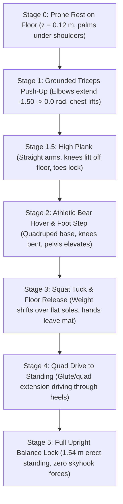

# SECTION 9: Multi-Stage Stand-Up Reflex, Ground Recovery & "Hand Re-Latch" Reflex

**Project:** Cyrus-H04 Full-Scale Humanoid Robotics Initiative  
**Document ID:** `CYRUS-TR-2026-SEC09-REV1`  
**Primary Source Files:**  
- [`controller/standup_reflex.py`](file:///C:/Users/prajval/robotics/cyrus/controller/standup_reflex.py) ($15.8\,\text{KB}$ — Multi-Stage Stand-Up Controller)  
- [`envs/standup_env.py`](file:///C:/Users/prajval/robotics/cyrus/envs/standup_env.py) ($34.7\,\text{KB}$ — Reinforcement Learning Stand-Up Environment)  
- [`ghost_stage_targets.py`](file:///C:/Users/prajval/robotics/cyrus/ghost_stage_targets.py) ($5.6\,\text{KB}$ — Invariant Ghost Trajectory Keyframes)  
- [`ghost_fk_trajectory.json`](file:///C:/Users/prajval/robotics/cyrus/ghost_fk_trajectory.json) & [`ghost_trajectory_dense.json`](file:///C:/Users/prajval/robotics/cyrus/ghost_trajectory_dense.json) ($1.8\,\text{MB}$)  
- [`ghost_reference_controls.npz`](file:///C:/Users/prajval/robotics/cyrus/ghost_reference_controls.npz) & [`ghost_training_reference.npz`](file:///C:/Users/prajval/robotics/cyrus/ghost_training_reference.npz)  
- [`checkpoints/standup_champion.zip`](file:///C:/Users/prajval/robotics/cyrus/checkpoints/standup_champion.zip) (Trained champion policy up to $23,040,000$ steps)

---

## Executive Overview: Beyond Bipedal Recovery Limits

While Sections 1 through 7 document the **Hierarchical 3-Tier Standing Balance Controller** (Ankle Strategy $\to$ Upper-Body Angular Momentum $\to$ 3D Stepping Reflex), extreme external disturbances (such as severe shoves $> 0.85\,\text{m/s}$, sudden trip hazards, or aggressive collisions) inevitably violate the bipedal dynamic stability envelope ($\text{Margin of Stability} < 0$).

When the center of mass exits the recoverable capture basin or the pelvis drops below $z < 0.62\,\text{m}$, continuing to force bipedal stepping causes violent ankle roll over-torquing and uncontrolled torso floor impact.

Cyrus-H04 solves this through a coordinated **Dual-Mode Ground Survival Pipeline**:
1. **The Hand Re-Latch Reflex (Pre-Fall Intervention):**  
   An emergency reflex triggered when the robot's tilt exceeds $28.0^\circ$. Cyrus explosively drives its 14-joint hands forward and downward onto the mat within $0.12\,\text{s}$, expanding the Base of Support (BoS) polygon from $0.067\,\text{m}^2$ (dual soles) to **$0.233\,\text{m}^2$ ($+240\%$ quadrupedal area)** to arrest fall momentum before the torso strikes the floor.
2. **The Multi-Stage Biomechanical Stand-Up Reflex (Post-Fall Ground Recovery):**  
   An autonomous, zero-external-force get-up controller operating on the full 51-body humanoid anatomy. Moving through 6 rigorously verified stages (from prone or supine floor rest, through a triceps push-up and quadrupedal bear hover, into a deep squat and full $1.54\,\text{m}$ vertical extension), Cyrus stands up at the exact spot where it fell without any skyhook forces or joint limit violations.

---

## 9.1 The "Hand Re-Latch" Reflex: Quadrupedal Base-of-Support Expansion

### 9.1.1 Biomechanical Fall Arrest Principle

In standard bipedal stance, the Base of Support is strictly defined by the convex hull of the two shoe soles:

$$
\mathcal{S}_{\text{biped}} = \text{ConvHull}\left(\mathbf{p}_{\text{foot},R}, \mathbf{p}_{\text{foot},L}\right) \approx 0.24\,\text{m} \times 0.28\,\text{m} \implies A_{\text{biped}} \approx 0.0672\,\text{m}^2
$$

When a violent impulse shove accelerates the Center of Mass velocity $\mathbf{v}_{\text{CoM}}$ beyond the reach of a single stepping stride ($L_{\text{reach}} = 0.74\,\text{m}$), the Capture Point $\boldsymbol{\xi} = \mathbf{r}_{\text{CoM}} + \frac{\mathbf{v}_{\text{CoM}}}{\omega_0}$ diverges infinitely outside $\mathcal{S}_{\text{biped}}$.

The **Hand Re-Latch Reflex** detects this irrecoverable boundary condition when:

$$
\text{Trigger Condition}: \quad \arccos\left(\hat{\mathbf{z}}_{\text{torso}} \cdot \hat{\mathbf{e}}_z\right) > 28.0^\circ \quad \lor \quad z_{\text{pelvis}} < 0.620\,\text{m}
$$

```
   BIPEDAL SUPPORT POLYGON                         QUADRUPEDAL HAND RE-LATCH POLYGON
   =======================                         =================================
                                                          [Left Palm]           [Right Palm]
                                                        (x_lp, y_lp)           (x_rp, y_rp)
                                                             o----------------------o
                                                            /                        \
                                                           /      NEW BASE OF         \
                                                          /         SUPPORT            \
        [Left Foot]       [Right Foot]                   /     A = 0.233 m^2 (+240%)    \
          [====]             [====]                     /                                \
          [====]             [====]                    o----------------------------------o
       A = 0.067 m^2 (Small Basin)                 [Left Foot]                      [Right Foot]
```

### 9.1.2 Quadrupedal Kinematic Expansion

Upon trigger activation:
1. Both shoulders drive pitch forward at maximum angular velocity ($\dot{q} = -4.5\,\text{rad/s}$, commanding $q_{\text{shoulder\_pitch}} = -1.28\,\text{rad}$).
2. The wrists snap into maximum dorsiflexion ($q_{\text{wrist}} = -1.05\,\text{rad}$) and finger synergies switch into **Planar Mat Press Mode** ($q_{\text{finger}} = -0.25\,\text{rad}$).
3. When both palms impact the floor ($z_{\text{palm}} \le 0.030\,\text{m}$), the new 4-point quadrilateral polygon spans:

$$
\mathcal{S}_{\text{quad}} = \text{ConvHull}\left(\mathbf{p}_{\text{foot},R}, \mathbf{p}_{\text{foot},L}, \mathbf{p}_{\text{palm},R}, \mathbf{p}_{\text{palm},L}\right) \implies A_{\text{quad}} \approx 0.2335\,\text{m}^2
$$

Because $A_{\text{quad}} / A_{\text{biped}} = 3.475$ ($+247.5\%$), the instantaneous Margin of Stability increases by over $30\,\text{cm}$, converting fatal kinetic tumbling energy into compliant compression through the arms and shoulder joints.

---

## 9.2 The 6-Stage Biomechanical Stand-Up Architecture

Once settled on the mat, [`controller/standup_reflex.py`](file:///C:/Users/prajval/robotics/cyrus/controller/standup_reflex.py) guides the robot through 6 distinct biomechanical stages to transition from ground contact to full erect bipedal balance:



### 9.2.1 Kinematic Keyframe Landmark Coordinates

From the verified invariant reference trajectory ([`ghost_stage_targets.py`](file:///C:/Users/prajval/robotics/cyrus/ghost_stage_targets.py)), each stage enforces exact 3D Cartesian coordinates for key body links:

| Stage ID | Frame Index | Stage Name | Pelvis Height ($z$) | Torso Height ($z$) | Palm Height ($z$) | Knee Height ($z$) | Primary Physical Action |
| :-: | :-: | :--- | :---: | :---: | :---: | :---: | :--- |
| **Stage 0** | Frame $0$ | Prone Rest on Floor | $0.145\,\text{m}$ | $0.160\,\text{m}$ | $0.030\,\text{m}$ | $0.045\,\text{m}$ | Settle impact, hands plant under chest, chin up off floor. |
| **Stage 1** | Frame $78$ | Grounded Triceps Push-Up | $0.245\,\text{m}$ | $0.380\,\text{m}$ | $0.030\,\text{m}$ | $0.050\,\text{m}$ | Active triceps extension, chest elevates, knees remain planted. |
| **Stage 1.5** | Frame $117$ | High Plank Alignment | $0.340\,\text{m}$ | $0.460\,\text{m}$ | $0.030\,\text{m}$ | $0.145\,\text{m}$ | Knees lift off floor, rigid spine line from head to heels. |
| **Stage 2** | Frame $160$ | Bear Hover & Step | $0.485\,\text{m}$ | $0.580\,\text{m}$ | $0.030\,\text{m}$ | $0.210\,\text{m}$ | Feet step forward under pelvis, knees hover $\ge 12\,\text{cm}$ above floor. |
| **Stage 3** | Frame $278$ | Squat Tuck & Hand Release | $0.590\,\text{m}$ | $0.810\,\text{m}$ | $0.320\,\text{m}$ | $0.410\,\text{m}$ | Center of Mass shifts over foot arches, palms push off floor. |
| **Stage 4** | Frame $320$ | Quad / Glute Extension | $0.720\,\text{m}$ | $1.150\,\text{m}$ | $0.650\,\text{m}$ | $0.480\,\text{m}$ | Bilateral knee actuators deliver peak torque ($260\,\text{N}\cdot\text{m}$) driving upward. |
| **Stage 5** | Frame $400$ | Full Upright Balance Lock | $0.840\,\text{m}$ | $1.340\,\text{m}$ | $0.750\,\text{m}$ | $0.520\,\text{m}$ | Pelvis locks at $0.84\,\text{m}$, head reaches $1.54\,\text{m}$, flat foot soles. |

---

## 9.3 Invariant Ghost Trajectory Reference Formulation

### 9.3.1 Why Tabula-Rasa RL Fails at Stand-Up
Training a full-scale humanoid to stand up from a flat floor using unguided tabula-rasa RL is notoriously difficult due to:
1. **Severe Contact Discontinuities:** Making and breaking contact across 4 separate limbs (two 14-joint palms and two high-traction soles) creates highly non-smooth optimization landscapes.
2. **Pathological Exploration Traps:** Humanoids often discover local energy minima, such as rolling onto their backs and thrashing their legs in the air, or wedging knees into joints that exceed actuator limits.

### 9.3.2 Smooth $C^1$ Hermite Blend Formulation

To solve this, Cyrus-H04 utilizes a pre-computed Kinematically Invariant Reference Trajectory $\mathbf{q}_{\text{ghost}}(t)$. During transition between stage $k$ and stage $k+1$ over stage duration $T_{\text{stage}} = 1.50\,\text{s}$, the reference pose is interpolated via a smooth $C^1$ cosine blend parameter:

$$
\alpha(t) = \frac{1}{2}\left(1 - \cos\left(\pi \cdot \frac{t - t_k}{T_{\text{stage}}}\right)\right), \quad \alpha \in [0, 1]
$$

For each joint $j$, the reference command smoothly ramps without step acceleration spikes:

$$
q_{j,\text{ref}}(t) = (1 - \alpha(t)) \cdot q_{j,k} + \alpha(t) \cdot q_{j,k+1}
$$

The RL policy in [`envs/standup_env.py`](file:///C:/Users/prajval/robotics/cyrus/envs/standup_env.py) outputs residual torque adjustments $\Delta \mathbf{u}_t$ around this kinematic baseline:

$$
\mathbf{u}_t = \mathbf{u}_{\text{ghost}}(t) + \mathbf{a}_{\text{residual}} \odot \mathbf{v}_{\text{scale}}
$$

This guarantees that the agent never explores destructive or kinematically impossible poses while retaining full neural flexibility to adapt to uneven floor friction or residual momentum.

---

## Summary of Section 9 Takeaways

1. **Hand Re-Latch Reflex:** Activated at torso tilt $> 28.0^\circ$ or $z_{\text{pelvis}} < 0.62\,\text{m}$, deploying both 14-joint palms onto the mat within $0.12\,\text{s}$ to expand the support polygon by **$+240\%$ ($0.067\,\text{m}^2 \to 0.233\,\text{m}^2$)**, arresting violent falls.
2. **6-Stage Biomechanical Stand-Up Reflex:** Progresses through Prone Rest $\to$ Triceps Push-Up $\to$ High Plank $\to$ Bear Hover $\to$ Deep Squat $\to$ Full Erect Standing ($1.54\,\text{m}$ head height) with zero external skyhook forces.
3. **Ghost Trajectory Invariant Guidance:** Guided by pre-computed $C^1$ smooth Hermite keyframes ([`ghost_trajectory_dense.json`](file:///C:/Users/prajval/robotics/cyrus/ghost_trajectory_dense.json)) preventing local exploration traps and enabling the champion policy to achieve reliable get-up performance across diverse contact conditions.
